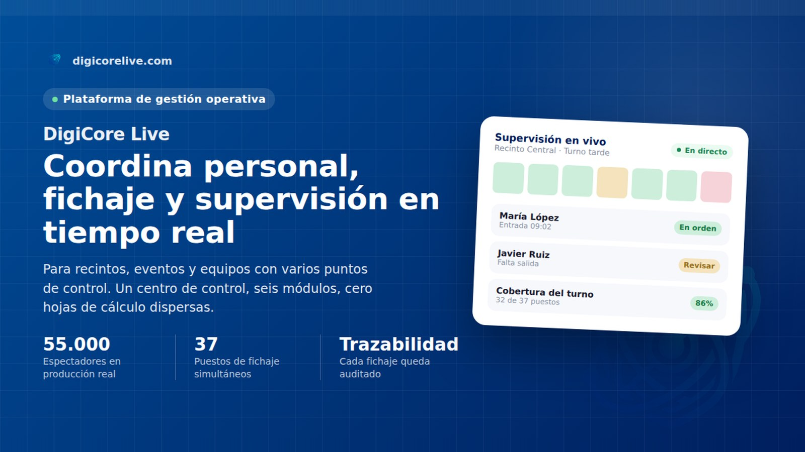
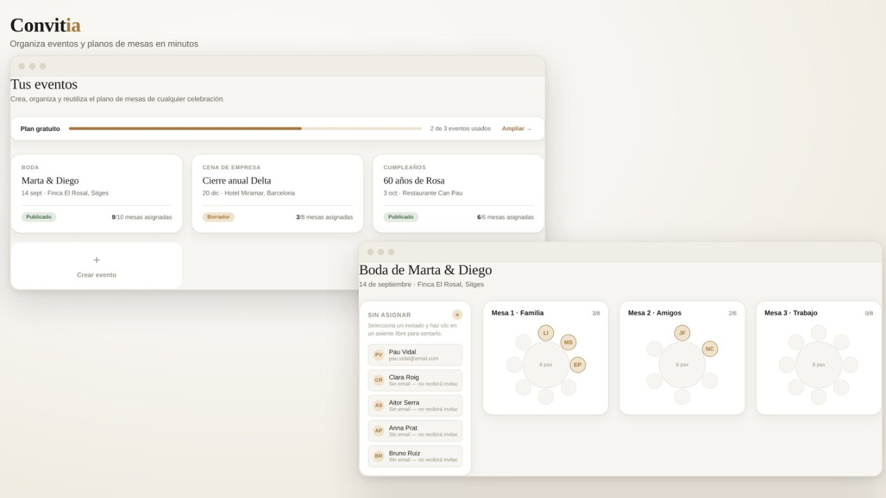
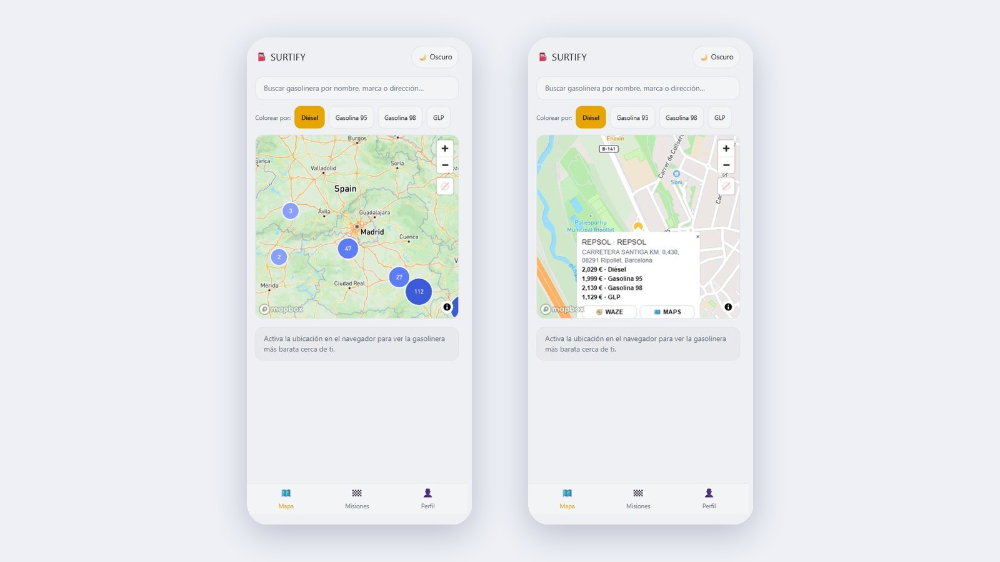
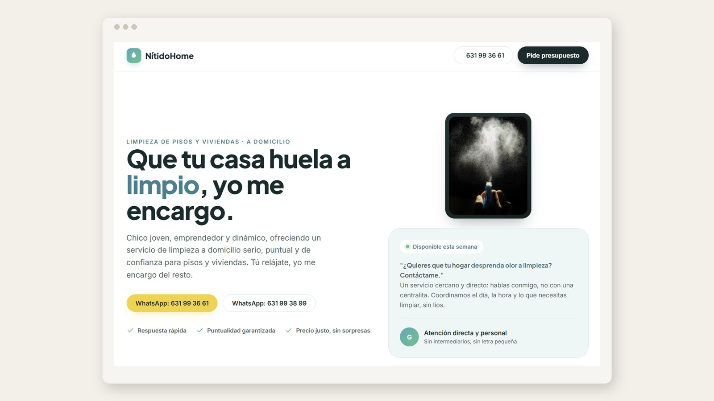

 

<h1 align="center">Guillermo Gámez</h1>

  <b>Desarrollador full-stack en Barcelona</b> 
  Fundador de DigiCore Live

  
  
  

  

 

---

## Mi historia

Pasé de ser encargado de bares en grandes eventos (Anella Olímpica de Montjuïc, RCDE, FCB, Zoo y Circuit de Catalunya) a crear el software que habría querido tener entonces.

Esa experiencia me dio algo que no se aprende solo programando: sé cómo trabaja la gente de verdad, con prisa, con presión y con herramientas que no siempre ayudan. Por eso creo software pensado para quien lo usa.

 

## Lo que hago

<table>
  <tr>
    <td width="33%" valign="top">
      <b>Aplicaciones a medida</b>  
      Software web para empresas y eventos, diseñado para el uso diario.
    </td>
    <td width="33%" valign="top">
      <b>Control de personal</b>  
      Fichaje y supervisión en tiempo real, incluso con miles de personas a la vez.
    </td>
    <td width="33%" valign="top">
      <b>De principio a fin</b>  
      Analizo el problema, diseño la solución, la programo, la publico y la mantengo.
    </td>
  </tr>
</table>

 

## Proyectos

| Proyecto | Qué resuelve | Acceso |
|:--|:--|:--|
| **DigiCore Live** | Coordinación de personal, fichaje y supervisión en eventos. Probada con 55.000 espectadores y 37 puestos a la vez. | [Abrir →](https://digicorelive.com) |
| **Convitia** | Organización de eventos y reparto de invitados en mesas. | [Abrir →](https://convitia.vercel.app/login) |
| **Surtify** | Precios de gasolineras para ahorrar en cada repostaje. | [Abrir →](https://surtify-b3wb.vercel.app/) |
| **NitidoHome** | Web de servicios de limpieza a domicilio, ya en producción. | [Abrir →](https://www.nitidohome.es/) |

 

## Así se ve

<table>
  <tr>
    <td width="50%" align="center">
       
      <b>DigiCore Live</b>
    </td>
    <td width="50%" align="center">
       
      <b>Convitia</b>
    </td>
  </tr>
  <tr>
    <td width="50%" align="center">
       
      <b>Surtify</b>
    </td>
    <td width="50%" align="center">
       
      <b>NitidoHome</b>
    </td>
  </tr>
</table>

 

## Tecnologías

| | |
|:--|:--|
| **Interfaz** |    |
| **Servidor y datos** |   |
| **Nube** |  |

 

---

<h2 align="center">¿Tienes un proyecto en mente?</h2>

  Respondo en menos de 48 horas, también fines de semana y festivos. 
  Antes de escribir código te preparo un boceto visual de tu proyecto, para que veas qué vas a recibir desde el primer momento.

<table align="center">
  <tr>
    <td align="center" width="50%">
      <b>Email</b> 
      <a href="mailto:gamezescobar-guillermo@digicorelive.com">gamezescobar-guillermo@digicorelive.com</a>
    </td>
    <td align="center" width="50%">
      <b>Teléfono</b> 
      +34 642 04 76 84
    </td>
  </tr>
  <tr>
    <td align="center" width="50%">
      <b>LinkedIn</b> 
      <a href="https://www.linkedin.com/in/guillermo-gamez-dev">guillermo-gamez-dev</a>
    </td>
    <td align="center" width="50%">
      <b>Instagram</b> 
      <a href="https://www.instagram.com/guille.gamezz">@guille.gamezz</a>
    </td>
  </tr>
</table>

 
